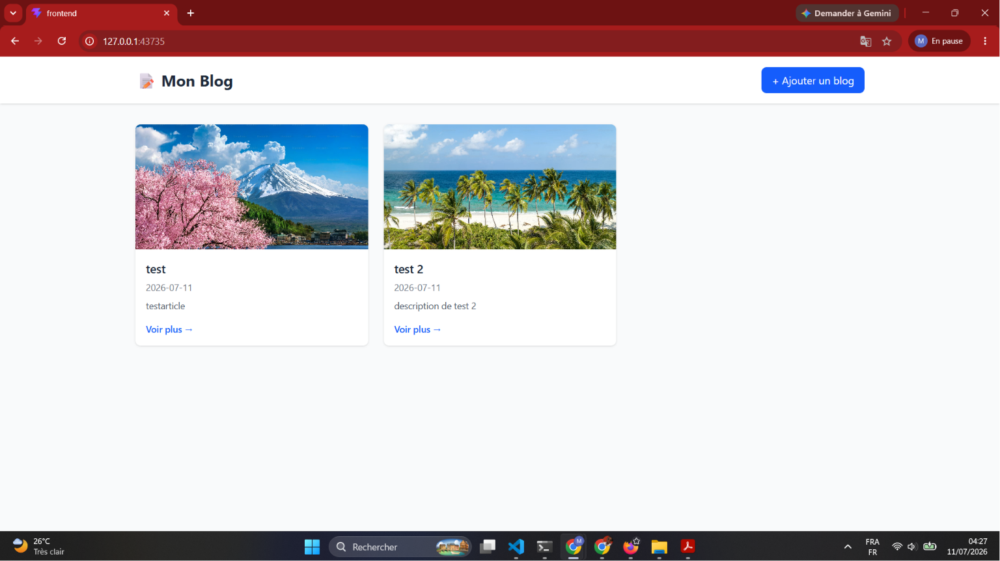
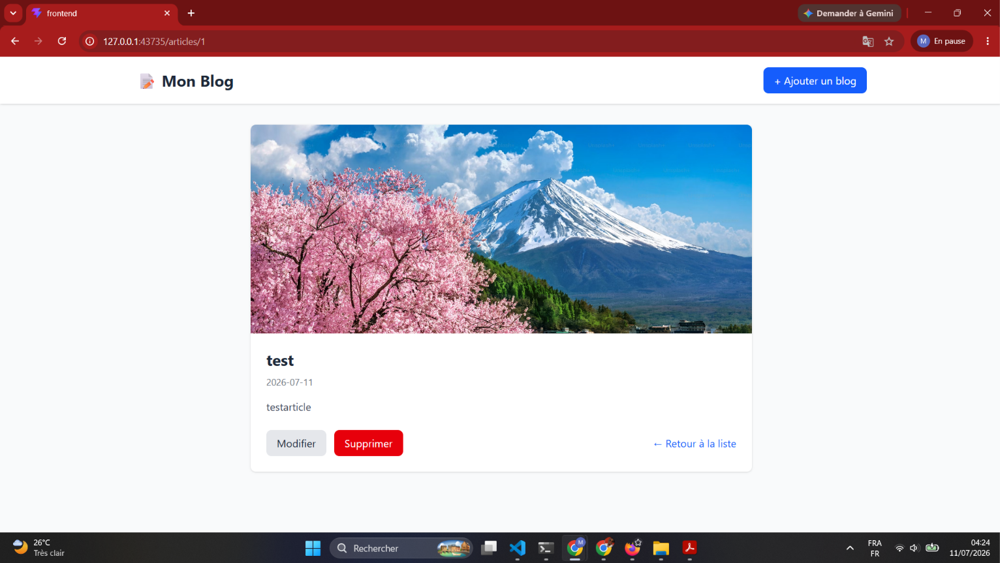
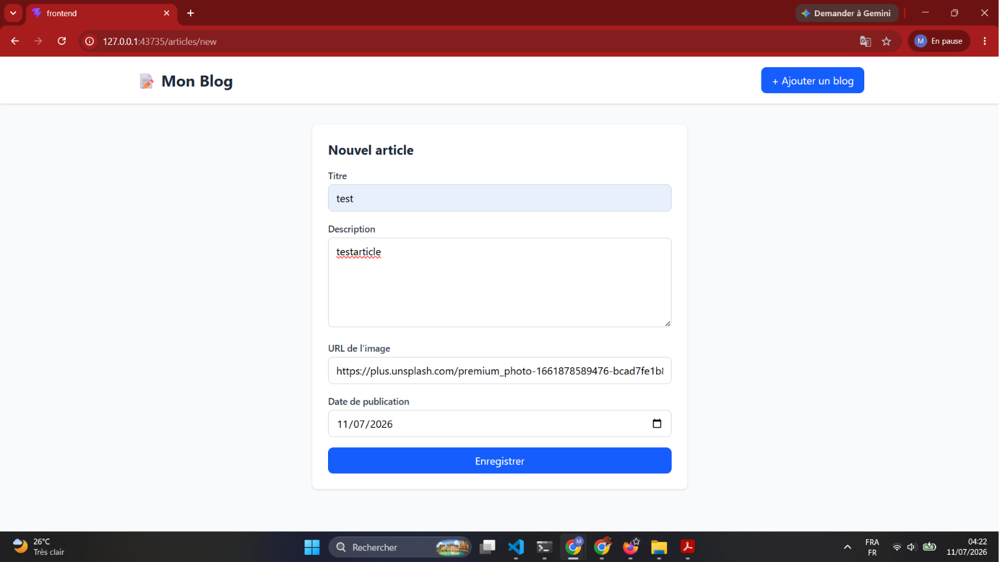

# Blog — Déploiement Kubernetes (Frontend + Backend)
Application de blog CRUD (Articles) déployée sur un cluster Kubernetes avec spring boot X react X PostegreSQL, 

## Architecture
Le frontend ne communique jamais directement avec les pods backend : toutes les requêtes passent par le Service Kubernetes correspondant (résolution DNS interne du cluster).

## Stack technique

- **Backend** : Spring Boot (Web, Data JPA, Actuator), PostgreSQL Driver, Lombok
- **Frontend** : React + TypeScript (Vite), React Router, Tailwind CSS, Axios
- **Base de données** : PostgreSQL
- **Conteneurisation** : Docker (builds multi-stage)
- **Orchestration** : Kubernetes (testé sur minikube)

## 1. Build et push des images Docker

### Backend
cd app/backend
docker build -t <DOCKER_USERNAME>/blog-backend:latest .
docker push <DOCKER_USERNAME>/blog-backend:latest

### Frontend
cd app/frontend
docker build -t <DOCKER_USERNAME>/blog-frontend:latest .
docker push <DOCKER_USERNAME>/blog-frontend:latest


> Les images utilisées dans les manifests sont déjà publiées sur Docker Hub : `blackmugi/blog-backend:latest` et `blackmugi/blog-frontend:latest`. Il n'est donc pas obligatoire de rebuild pour tester le déploiement.

## 2. Déploiement sur Kubernetes

```bash
kubectl apply -f k8s/
```

Cette commande crée, dans l'ordre : le Namespace, les ressources PostgreSQL (Secret, ConfigMap, PVC, Deployment, Service), les ressources backend (ConfigMap, Deployment, Service), puis les ressources frontend (Deployment, Service).

### Vérifier le déploiement

```bash
kubectl get pods -n blog-app
```

Tous les pods doivent passer à l'état `Running` avec `READY 1/1` (ou `2/2` selon le nombre de réplicas).

## 3. Accéder à l'application

### Avec minikube

```bash
minikube service frontend-service -n blog-app --url
```

Ouvre l'URL affichée dans un navigateur.

### Sur un cluster classique (accès direct via NodePort)

```bash
kubectl get nodes -o wide
```

Récupère l'IP externe/interne d'un nœud, puis ouvre :
## Aperçu de l'application

### Liste des articles


### Détail d'un article


### Formulaire de création

